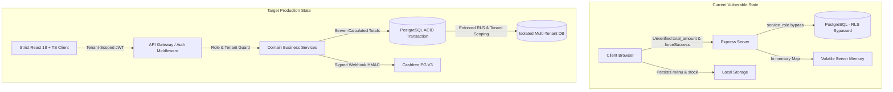
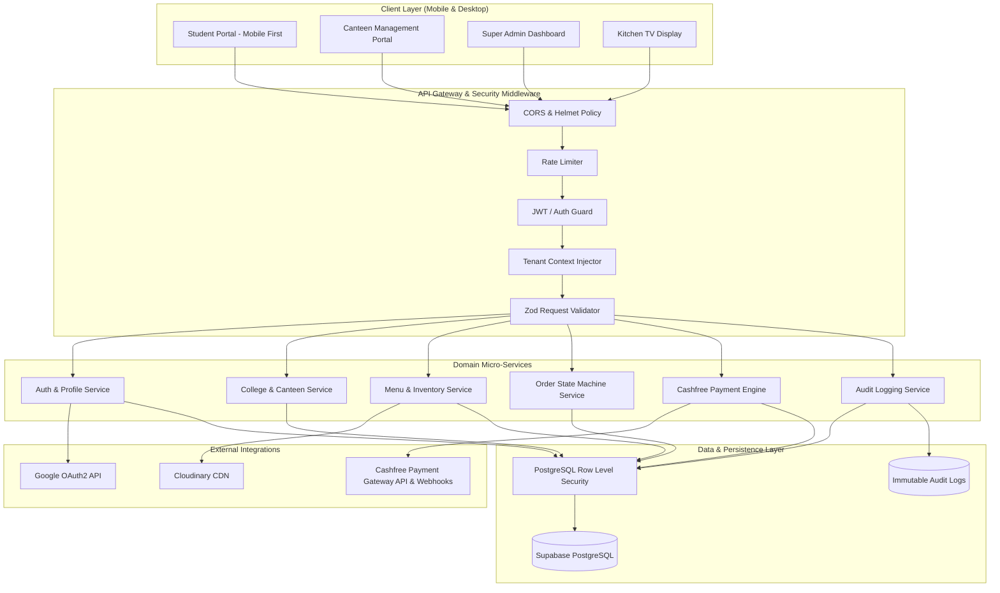
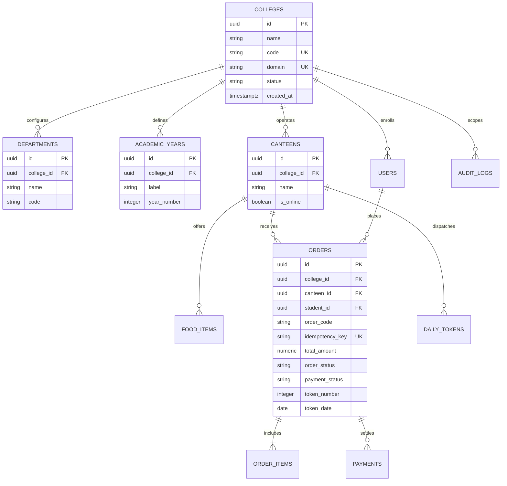
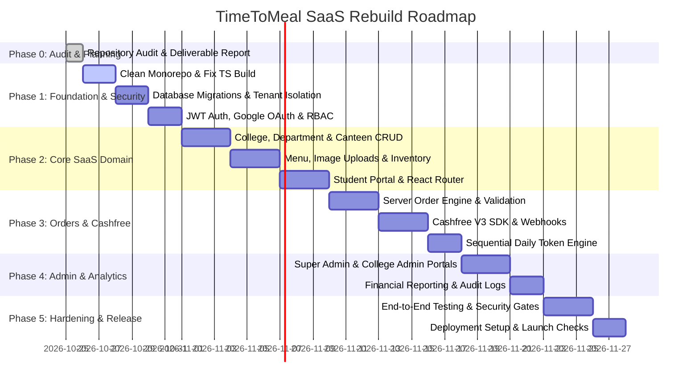

# TimeToMeal (TTM) — Production-Ready Multi-Tenant SaaS Rebuild Report

**Document Version:** 1.0.0  
**Date:** October 25, 2026  
**Status:** Complete Phase 0 Inspection & SaaS Rebuild Blueprint  
**Authors:** Senior SaaS Architect, Full-Stack Database & Security Engineering Team  

---

## 1. Missing Repository Documentation Notice

In accordance with Phase 0 audit guidelines, the repository was inspected for mandatory reference documentation:
- `docs/API_DOCUMENTATION.md` — **Present** (inspected)
- `docs/ARCHITECTURE.md` — **Present** (inspected)
- `docs/CODING_STANDARD.md` — **Present** (inspected)
- `docs/DATABASE_ER.md` — **Present** (inspected)
- `docs/DEPLOYMENT.md` — **Present** (inspected)
- `docs/SECURITY.md` — **Present** (inspected)
- `docs/TESTING.md` — **Present** (inspected)
- `AUDIT_AND_GAP_ANALYSIS.md` — **MISSING** (File does not exist in root or any subfolder). This report fulfills and expands upon that gap.

---

## A. Executive Summary

### Current State
TimeToMeal (TTM) was conceived as a multi-college, multi-canteen ordering and counter management platform. However, the existing codebase is in a **hybrid, broken transition state** between an early single-college prototype and a monorepo restructuring:
1. **Critical Payment Bypass & Mock Mode**: The payment flow is fundamentally insecure. The frontend explicitly submits `{ forceSuccess: true }` to `/api/payments/verify`, and if backend connectivity fails, the browser creates a synthetic order marked as `paid` and `preparing`. In the backend, a mock payment simulator route (`/api/payments/simulate-success`) allows arbitrary status overrides without authentication.
2. **Absence of Server-Side Authorization**: While JWT verification and role-check middleware functions exist (`auth.middleware.ts`), they are **not attached to any operational routes** in `routes/index.ts`. All administrative, college, canteen, meal, cart, and order endpoints are completely unprotected.
3. **Pseudo-Multi-Tenancy & Broken Isolation**: The database contains multi-tenant foreign keys (`college_id`, `canteen_id`), but Row Level Security (RLS) is written for Supabase Auth JWT claims (`auth.uid()`), whereas the backend Express server signs custom JWTs and connects via the administrative `SUPABASE_SERVICE_ROLE_KEY`, completely bypassing RLS. Furthermore, Express controllers do not enforce tenant scoping.
4. **Severe Frontend Degradation**: TypeScript compilation fails with **223 errors across 18 files**. React Router is absent; view switching is hardcoded through state flags in `App.tsx`. Order placement and inventory management fall back to browser `localStorage`.
5. **Zero Automated Testing**: Test files in `tests/e2e/`, `tests/integration/`, and `tests/unit/` are 0-byte empty files.

### Objectives of the Rebuild
- Transform TTM into a genuine, enterprise-grade multi-tenant SaaS platform where multiple colleges operate in strict logical isolation.
- Enforce authoritative backend order calculation, stock validation, atomic transactions, and cryptographically verified Cashfree payments.
- Re-architect the frontend with strict TypeScript, React Router, tenant context, and mobile-first UX.
- Establish end-to-end security: role-based access control (RBAC), signed Cloudinary uploads, rate limiting, and tamper-proof audit trails.

### Expected Outcome
A robust, horizontally scalable SaaS system supporting thousands of concurrent student orders across multiple collegiate institutions, with 100% database integrity, zero unverified payments, and centralized super-admin governance.

---

## B. Existing System Audit

### 1. Technology Stack & Infrastructure
- **Frontend**: React 19.2.3, Vite 6.2.0, Tailwind CSS (injected via CDN in `index.html`), Lucide icons, Motion/React. (No client-side router configured; 223 TypeScript errors).
- **Backend**: Node.js with Express 5.2.1, TypeScript 5.8.2, `dotenv`, `cors`, `helmet`, `jsonwebtoken`, `bcryptjs`, `zod`.
- **Database**: Supabase PostgreSQL (`uveefyorkrcyfzkmpakn.supabase.co`).
- **Integrations**: Cashfree Payment Gateway SDK/API, Cloudinary v2, Google OAuth (currently simulated).
- **Tooling & Monorepo**: Incomplete npm workspaces setup (`apps/frontend`, `apps/backend`, `packages/*`). `apps/backend` contains a nested `.git` repository pointing to GitHub branch `master` while the root repository tracks `main`.

### 2. Module-by-Module Audit

| Module | Observed Status | Evidence / File Path | Critical Defects |
|---|---|---|---|
| **Authentication & RBAC** | Partially Working / Insecure | `apps/backend/src/services/index.ts`<br>`apps/backend/src/routes/index.ts` | Passwords hashed with bcrypt, but custom JWTs not verified on routes. Hardcoded fallback JWT secret in `config/index.ts`. Google Auth is mock-only. |
| **Tenant Isolation** | Non-Existent in Runtime | `apps/backend/src/server.ts`<br>`supabase/migrations/05_rls.sql` | Backend connects with `service_role` key bypassing RLS. Express queries do not filter by tenant context from authenticated tokens. |
| **Order Management** | Divergent & Inconsistent | `apps/backend/src/server.ts:85`<br>`apps/backend/src/repositories/index.ts:335`<br>`apps/frontend/src/App.tsx:94-114` | Two competing order creation endpoints (`/api/payments/create-order` vs `/api/v1/orders`). Server trusts client-submitted `total_amount` and `price_per_unit`. Inventory decremented in browser `localStorage`. |
| **Cashfree Payments** | Broken / Insecure | `apps/backend/src/server.ts:281-348`<br>`apps/backend/src/config/index.ts:14`<br>`apps/frontend/src/components/payment/CashfreeCheckoutModal.tsx:130` | `config/index.ts` sets `cashfreeSecretKey` to Cloudinary API secret by mistake. `/api/payments/verify` honors `forceSuccess: true`. Webhook handler in `controllers/index.ts` does nothing. |
| **Image Uploads** | Unprotected Proxy | `apps/backend/src/server.ts:556-589`<br>`apps/backend/src/services/CloudinaryService.ts` | Base64 validation exists, but upload and deletion endpoints have zero authentication or permission checks. |
| **Student Portal** | Fragmented & Brittle | `apps/frontend/src/components/student/StudentView.tsx`<br>`apps/frontend/src/components/auth/Login.tsx` | Colleges and departments hardcoded in client. Offline fallback synthesizes paid orders. Type mismatch breaks build. |
| **Canteen Management** | Partial / Desynced | `apps/frontend/src/components/canteen/MenuCatalogView.tsx`<br>`apps/frontend/src/components/canteen/CanteenManagementView.tsx` | Missing React imports (`useEffect`). Canteen online/offline toggle stored in browser `localStorage`. |
| **SaaS Super Admin** | Broken Stub | `apps/backend/src/routes/index.ts:71-93`<br>`apps/frontend/src/components/dashboard/AdminView.tsx` | `GET /api/v1/admin/dashboard` is unauthenticated, returns hardcoded `totalRevenue: 0`. Admin frontend has 47 TypeScript errors. |
| **Audit & Reporting** | Non-Functional | `supabase/migrations/02_tables.sql`<br>`scripts/backup.ts` | `audit_logs` table has no `college_id`. `scripts/backup.ts` and `seed.ts` are 0-byte empty files. |
| **Automated Testing** | Absent | `tests/unit/example.test.ts`<br>`tests/integration/api.test.ts`<br>`tests/e2e/checkout.spec.ts` | All test files are 0 bytes. Zero test coverage. |

---

## C. Gap Analysis: Current State vs. Production Multi-Tenant SaaS



### Detailed Gap Matrix

| Domain | Current Implementation | Production Requirement | Priority | Impact | Proposed Solution |
|---|---|---|---|---|---|
| **Multi-Tenancy** | `college_id` exists in schema but ignored by server queries; backend bypasses RLS with `service_role`. | Strict tenant isolation where every query is scoped by `tenant_id` (`college_id`) derived exclusively from server-verified JWT. | **P0** | Severe data leak across colleges | Implement tenant context middleware, tenant-scoped repositories, and tenant-isolated database policies. |
| **Payment Integrity** | `forceSuccess: true` accepted on verification endpoint; frontend creates fake orders on error; fallback credentials hardcoded. | Cryptographic verification of Cashfree orders server-side; strict webhook signature verification; idempotent transitions. | **P0** | Free food theft, financial loss | Strip client overrides; implement server-side Cashfree V3 SDK with HMAC-SHA256 signature checks and database idempotency keys. |
| **Order Pricing & Inventory** | Client sends item prices and total order amount; stock decremented in client `localStorage`. | Server fetches item prices from DB, calculates subtotal/taxes, and reserves stock inside an atomic PostgreSQL transaction. | **P0** | Price tampering, overselling | Implement `OrderService.createOrder` with server pricing recalculation and `SELECT FOR UPDATE` stock reservation. |
| **API Security** | All routes in `routes/index.ts` lack authentication middleware; Cloudinary endpoints open to public. | Every private endpoint guarded by `authenticateJwt`, `authorizeRoles`, and tenant boundary checks. | **P0** | Total unauthorized system access | Attach `authenticateJwt` and `requireRole` to all routes; secure Cloudinary with signed upload signatures. |
| **Identity & Auth** | Google OAuth is mock-only; fallback JWT secret hardcoded in codebase. | Real Google OAuth 2.0 integration for students; secure secret management; Supabase Auth or hardened JWT server. | **P0** | Account hijacking, credential theft | Implement standard Google OAuth verify token flow; enforce strong environment secrets; remove hardcoded fallbacks. |
| **Frontend Architecture** | No router; state managed in `localStorage`; 223 TypeScript compilation errors; runtime Tailwind CDN. | React Router v6; centralized React Query / Zustand state; strict TypeScript compilation (zero errors); build-time PostCSS/Tailwind. | **P1** | Inoperable in production build | Reconstruct frontend routes, resolve all TypeScript interface mismatches, integrate Vite PostCSS pipeline. |
| **Department & Academic Year** | Hardcoded text arrays in `Login.tsx`; no relational tables. | Relational `departments` and `academic_years` tables linked to `college_id` with management CRUD. | **P1** | Inability to configure new colleges | Add `departments` and `academic_years` tables with migrations and admin configuration APIs. |
| **Token Management** | Random strings (`TTM-XXXX`) generated in repository; no daily reset or canteen sequence. | Atomic sequential daily token counter (`#1`, `#2`, ...) reset daily per canteen at 00:00. | **P1** | Kitchen confusion, duplicate tokens | Implement database sequence/trigger for `canteen_id + token_date` daily token generation. |
| **Testing & CI/CD** | Empty 0-byte test files; no CI pipeline; nested git repository in `apps/backend`. | Unit, integration, and security test suites; Git repository cleanup; automated CI verification. | **P1** | Regression risk, broken builds | Remove nested `.git`, implement Vitest/Supertest test suites covering authentication, orders, payments, and multi-tenancy. |

---

## D. Verified Findings Ranked by Severity

### P0 — Critical Security, Data Loss, or Payment Integrity Defects

#### Finding 1: Explicit Payment Verification Bypass via `forceSuccess`
- **File Path:** [apps/backend/src/server.ts](file:///home/sanjay/Desktop/sanjay/CURRENT-WORKING/Time-To-Meal/version-01.25.10.26/03.06.04/apps/backend/src/server.ts#L321-L329) & [CashfreeCheckoutModal.tsx](file:///home/sanjay/Desktop/sanjay/CURRENT-WORKING/Time-To-Meal/version-01.25.10.26/03.06.04/apps/frontend/src/components/payment/CashfreeCheckoutModal.tsx#L127-L134)
- **Observed Evidence:**
  ```typescript
  // server.ts line 322:
  if (verifiedStatus === 'PAID' || req.body.forceSuccess) {
    if (order) {
      order.payment_status = 'paid';
      ...
  ```
  ```typescript
  // CashfreeCheckoutModal.tsx line 130:
  body: JSON.stringify({ orderId, forceSuccess: true })
  ```
- **Impact:** Any user can mark any order as paid without executing a financial transaction.
- **Recommended Correction:** Completely remove `req.body.forceSuccess`. Require authoritative server-to-server verification with Cashfree API or cryptographically verified webhook before setting `payment_status = 'PAID'`.

#### Finding 2: Unauthenticated Webhook and Signature Verification Bypass
- **File Path:** [apps/backend/src/server.ts](file:///home/sanjay/Desktop/sanjay/CURRENT-WORKING/Time-To-Meal/version-01.25.10.26/03.06.04/apps/backend/src/server.ts#L425-L445)
- **Observed Evidence:**
  ```typescript
  if (signature && timestamp && cashfreeSecretKey) {
    // verify HMAC
  }
  // If signature or secret key is missing, verification is silently skipped!
  const event = req.body;
  if (isSuccess) { ... mark as paid ... }
  ```
- **Impact:** An attacker can POST arbitrary JSON payloads without headers to `/api/payments/webhook` and force orders into `PAID` state.
- **Recommended Correction:** Reject any webhook request that lacks valid `x-webhook-signature` and `x-webhook-timestamp` headers with HTTP 401. Enforce constant-time timing-safe buffer comparison.

#### Finding 3: Complete Absence of Authentication on All Core Backend Routes
- **File Path:** [apps/backend/src/routes/index.ts](file:///home/sanjay/Desktop/sanjay/CURRENT-WORKING/Time-To-Meal/version-01.25.10.26/03.06.04/apps/backend/src/routes/index.ts#L25-L93)
- **Observed Evidence:**
  Routes are mounted without middleware:
  ```typescript
  apiRouter.post('/api/v1/colleges', CollegeController.create);
  apiRouter.delete('/api/v1/colleges/:id', CollegeController.delete);
  apiRouter.get('/api/v1/admin/dashboard', async (req, res) => ...);
  apiRouter.get('/api/v1/admin/students', AdminController.getAllStudents);
  ```
- **Impact:** Any unauthenticated internet user can create/delete colleges, query super-admin dashboard metrics, dump all student personal information, and modify canteen menus.
- **Recommended Correction:** Mount `authenticateJwt` across all private routes and enforce role guards (`authorizeRoles('SUPER_ADMIN')`, `authorizeRoles('CANTEEN_ADMIN')`).

#### Finding 4: Client-Controlled Order Pricing and Total Calculation
- **File Path:** [apps/backend/src/validation/schemas.ts](file:///home/sanjay/Desktop/sanjay/CURRENT-WORKING/Time-To-Meal/version-01.25.10.26/03.06.04/apps/backend/src/validation/schemas.ts#L29-L40) & [repositories/index.ts](file:///home/sanjay/Desktop/sanjay/CURRENT-WORKING/Time-To-Meal/version-01.25.10.26/03.06.04/apps/backend/src/repositories/index.ts#L338-L347)
- **Observed Evidence:**
  `CreateOrderSchema` accepts `total_amount` and `items[].price_per_unit` from client. `OrderRepository.createOrder` inserts these client-supplied values directly into the database without querying `food_items` for the true catalog price.
- **Impact:** A malicious actor can submit an order with `total_amount: 0.01` or `price_per_unit: 0.00` for expensive food items.
- **Recommended Correction:** The backend must fetch item IDs from the database, verify availability and canteen ownership, compute line totals and grand totals on the server, and reject any mismatched request.

#### Finding 5: Hardcoded Production Secrets and Mismatched Payment Keys
- **File Path:** [apps/backend/src/config/index.ts](file:///home/sanjay/Desktop/sanjay/CURRENT-WORKING/Time-To-Meal/version-01.25.10.26/03.06.04/apps/backend/src/config/index.ts#L6-L15)
- **Observed Evidence:**
  ```typescript
  jwtSecret: process.env.JWT_SECRET || 'super-secret-jwt-key-timetomeal-2026',
  cashfreeAppId: process.env.CASHFREE_APP_ID || 'TEST1115864987dc532ebfcdde0745ef94685111',
  cashfreeSecretKey: process.env.CASHFREE_SECRET_KEY || 'TvYRWi6_uF8azvYG0V_SBJAJgjE',
  ```
  `TvYRWi6_uF8azvYG0V_SBJAJgjE` is actually the Cloudinary API secret pasted into the Cashfree secret key field.
- **Impact:** If `JWT_SECRET` is unset, tokens can be forged by anyone with knowledge of the default key. Cashfree calls fail or use invalid credentials.
- **Recommended Correction:** Throw a fatal error on server startup if any required environment variable (`JWT_SECRET`, `CASHFREE_APP_ID`, `CASHFREE_SECRET_KEY`, `DATABASE_URL`) is missing in production.

#### Finding 6: Unprotected Cloudinary Upload and Deletion Endpoints
- **File Path:** [apps/backend/src/server.ts](file:///home/sanjay/Desktop/sanjay/CURRENT-WORKING/Time-To-Meal/version-01.25.10.26/03.06.04/apps/backend/src/server.ts#L556-L589)
- **Observed Evidence:**
  `POST /api/cloudinary/upload` and `POST /api/cloudinary/delete` have no authentication or rate limiting.
- **Impact:** Anyone can upload arbitrary images to Cloudinary (incurring quota costs) or delete existing canteen menu photos by passing arbitrary `public_id` values.
- **Recommended Correction:** Require `authenticateJwt` and `authorizeRoles('CANTEEN_ADMIN', 'SUPER_ADMIN')` on all media endpoints; verify that the user owns the canteen folder being modified.

---

### P1 — Essential Functionality & Serious Reliability Issues

#### Finding 7: Complete TypeScript Build Breakdown (223 Errors)
- **File Path:** 18 frontend files including `apps/frontend/src/components/auth/Login.tsx`, `MenuCatalogView.tsx`, `StudentView.tsx`, `AdminPaymentDetailsView.tsx`.
- **Observed Evidence:** Running `npx tsc --noEmit` yields 223 compilation errors (`Cannot find name 'MockUserPreset'`, `Cannot find name 'useEffect'`, `Module has no exported member 'BankDetails'`, `Property 'imageUrl' does not exist on type 'MenuItem'`).
- **Impact:** The frontend application cannot be cleanly built or deployed to staging/production.
- **Recommended Correction:** Standardize core TypeScript definitions in `@timetomeal/shared-types`, align property naming (`image_url` vs `imageUrl`), and fix all missing imports.

#### Finding 8: Client-Side Inventory Manipulation in `localStorage`
- **File Path:** [apps/frontend/src/App.tsx](file:///home/sanjay/Desktop/sanjay/CURRENT-WORKING/Time-To-Meal/version-01.25.10.26/03.06.04/apps/frontend/src/App.tsx#L94-L115)
- **Observed Evidence:**
  When orders are placed, `App.tsx` decrements `stock_offline` and `stock_online` in browser memory and saves the result to `localStorage.setItem('hb_menu', ...)`.
- **Impact:** Stock is not decremented in the PostgreSQL database. Concurrent students see stale stock, causing kitchen overselling.
- **Recommended Correction:** Remove all client-side stock mutation logic. Manage inventory deductions atomically in PostgreSQL during order confirmation.

#### Finding 9: In-Memory Volatile Order Store in Backend
- **File Path:** [apps/backend/src/server.ts](file:///home/sanjay/Desktop/sanjay/CURRENT-WORKING/Time-To-Meal/version-01.25.10.26/03.06.04/apps/backend/src/server.ts#L55-L57)
- **Observed Evidence:**
  `const activeOrdersStore = new Map<string, OrderState>();` and `const processedWebhooks = new Set<string>();`.
- **Impact:** If the server restarts or scales across multiple containers (Render, Kubernetes), all active order states and webhook idempotency records are wiped.
- **Recommended Correction:** Store order status and webhook idempotency keys strictly in PostgreSQL tables with transactional isolation.

#### Finding 10: Missing `departments` and `academic_years` Relational Modeling
- **File Path:** [supabase/migrations/02_tables.sql](file:///home/sanjay/Desktop/sanjay/CURRENT-WORKING/Time-To-Meal/version-01.25.10.26/03.06.04/supabase/migrations/02_tables.sql#L142-L154)
- **Observed Evidence:**
  `departments` and `academic_years` tables do not exist. `department` is stored as free-form text and `batch_year` as an integer on `user_profiles`.
- **Impact:** Colleges cannot configure their official departments, degrees, or academic years.
- **Recommended Correction:** Create `departments` and `academic_years` tables scoped by `college_id` with foreign key relationships to student profiles.

---

### P2 — Important Usability, Performance, and Architecture Issues

#### Finding 11: Absence of Client-Side URL Routing
- **File Path:** [apps/frontend/src/App.tsx](file:///home/sanjay/Desktop/sanjay/CURRENT-WORKING/Time-To-Meal/version-01.25.10.26/03.06.04/apps/frontend/src/App.tsx#L162-L196)
- **Observed Evidence:** `App.tsx` uses conditional `user.role` rendering without React Router. Pages in `apps/frontend/src/pages/` are unused orphans.
- **Impact:** Users cannot bookmark URLs, use the browser back/forward buttons, or access direct administrative pages.
- **Recommended Correction:** Implement React Router v6 with protected route layouts (`/student/*`, `/canteen/*`, `/admin/*`).

#### Finding 12: Tailwind CSS Loaded via Runtime CDN in Production HTML
- **File Path:** [apps/frontend/index.html](file:///home/sanjay/Desktop/sanjay/CURRENT-WORKING/Time-To-Meal/version-01.25.10.26/03.06.04/apps/frontend/index.html#L13-L35)
- **Observed Evidence:** `<script src="https://cdn.tailwindcss.com"></script>` is injected in the document head with runtime configuration.
- **Impact:** Large bundle latency, flashes of unstyled content (FOUC), and CSP security risks.
- **Recommended Correction:** Integrate Tailwind CSS as a build-time PostCSS plugin via Vite.

#### Finding 13: Nested Git Repository inside `apps/backend/`
- **File Path:** `apps/backend/.git`
- **Observed Evidence:** `apps/backend/` contains an independent `.git` folder tracking branch `master`, while the root workspace tracks `main`.
- **Impact:** Git commits in the root workspace ignore files inside `apps/backend`, leading to untracked code loss.
- **Recommended Correction:** Remove `apps/backend/.git` and track the entire monorepo cleanly from the root repository.

---

### P3 — Enhancement & Optimization

#### Finding 14: Hardcoded Single Admin Seed
- **File Path:** [supabase/migrations/09_seed.sql](file:///home/sanjay/Desktop/sanjay/CURRENT-WORKING/Time-To-Meal/version-01.25.10.26/03.06.04/supabase/migrations/09_seed.sql#L22-L31)
- **Observed Evidence:** Single static super-admin with fixed UUID `a0000001-0000-4000-a000-000000000001` and known default password.
- **Recommended Correction:** Provide an environment-driven seed runner or CLI command (`npm run seed:admin`) that generates an initial super-admin with a securely generated random password.

---

## E. Existing Functionality Worth Preserving

Despite the architectural gaps, the codebase contains significant design assets, UI components, and domain logic that will be preserved and refined:
1. **Design Tokens & Aesthetic UI Components**: The student menu catalog, dietary filter pills (Veg/Non-Veg/Egg), food card layouts, and mobile bottom navigation in `StudentView.tsx` are visually engaging and tailored for campus canteens.
2. **Canteen Kitchen Workflow Components**: The kanban-style kitchen order view (`StaffView.tsx` / `OrderPipelineStepper.tsx`) with ticket statuses (`PENDING` -> `PREPARING` -> `READY` -> `COMPLETED`) is well-structured and will be retained with backend socket synchronization.
3. **Cloudinary Service Architecture**: `CloudinaryService.ts` contains robust validation for base64 image MIME types, payload size bounds, and folder hierarchy logic.
4. **Relational Schema Foundation**: The baseline table structure in `supabase/migrations/02_tables.sql` (`colleges`, `canteens`, `food_items`, `food_images`, `tokens`, `daily_sales`, `canteen_settings`) is well-modeled and provides an excellent foundation for the target schema.
5. **Clean Architecture Module Skeleton**: The separation of DTOs, interfaces, controllers, and services in `apps/backend/src` reflects sound architectural intent and will be corrected to follow strict dependency injection.

---

## F. Target SaaS Product Requirements Document (PRD)

### 1. User Personas & Roles
- **Platform Super Admin (TimeToMeal SaaS Owner)**: Global oversight, onboarding colleges, creating canteen administrators, platform financial reporting, system health.
- **College Administrator**: Oversees canteens within their college, manages academic departments, academic years, and student enrollment policies.
- **Canteen Owner / Staff**: Manages food catalog, real-time availability, order kitchen pipeline, token dispatching, and counter sales.
- **Student**: Mobile-first user who authenticates via Google OAuth, selects their college canteen, orders meals, pays via Cashfree, and tracks live order tokens.

### 2. Multi-Tenant Boundary Model
A **Tenant** is defined at the **College** level:
- Every `Student`, `Canteen`, `Department`, and `AcademicYear` belongs to a single `College` (`college_id`).
- A `College` can host one or more `Canteens`.
- A student from *College A* cannot browse menus, submit orders, or access receipts from *College B*.
- A canteen staff member from *Canteen 1* cannot view or modify orders from *Canteen 2*.

---

## G. Target System Architecture



---

## H. Target Database Design & Multi-Tenant Strategy

### 1. Relational Entity Schema Extensions
In addition to the baseline tables, the schema will be hardened with explicit multi-tenant relations:



### 2. Tenant Isolation Strategy
1. **Application-Level Enforced Scoping**: The Express authentication middleware extracts `college_id` from the verified JWT and injects it into `req.tenantId`. All service and repository methods must accept `tenantId` and enforce `WHERE college_id = :tenantId`.
2. **Database-Level Row Level Security (RLS)**: For direct database queries or Supabase client connections, RLS policies verify:
   ```sql
   CREATE POLICY tenant_isolation_orders ON orders
     FOR ALL
     USING (college_id = (current_setting('app.current_tenant_id', true))::uuid);
   ```
3. **Strict Cross-Tenant Testing**: Automated integration tests will verify that a user authenticated with College A's token receiving College B's resource ID receives an immediate `403 Forbidden`.

---

## I. Target API Specification

| Endpoint | Method | Role | Request Body | Response Format | Idempotency |
|---|---|---|---|---|---|
| `/api/v1/auth/google` | POST | Public | `{ idToken: string, collegeId: string }` | `{ token: string, user: UserProfile }` | No |
| `/api/v1/auth/me` | GET | Authenticated | None | `{ user: UserProfile, permissions: string[] }` | No |
| `/api/v1/colleges` | GET | Authenticated | None | `{ colleges: CollegeSummary[] }` | No |
| `/api/v1/colleges` | POST | SUPER_ADMIN | `CreateCollegeSchema` | `{ college: CollegeDetail }` | No |
| `/api/v1/canteens/:canteenId/menu` | GET | Authenticated | None | `{ categories: Category[], items: FoodItem[] }` | No |
| `/api/v1/canteens/:canteenId/menu/items` | POST | CANTEEN_ADMIN | `CreateFoodItemSchema` | `{ item: FoodItem }` | No |
| `/api/v1/orders` | POST | STUDENT | `CreateOrderSchema` (item IDs + quantities) | `{ order: Order, cashfreeSession: SessionData }` | **Yes** (`x-idempotency-key`) |
| `/api/v1/orders/:orderId` | GET | Order Owner / Canteen | None | `{ order: OrderDetail, timeline: Event[] }` | No |
| `/api/v1/orders/:orderId/status` | PATCH | CANTEEN_STAFF | `{ status: OrderStatus }` | `{ success: true, newStatus: string }` | No |
| `/api/v1/payments/cashfree/webhook` | POST | Cashfree PG | Webhook payload | `{ status: 'ok' }` | **Yes** (verified signature) |
| `/api/v1/payments/verify/:orderId` | POST | Order Owner | None | `{ verified: boolean, paymentStatus: string }` | No |
| `/api/v1/admin/analytics` | GET | SUPER_ADMIN | `?startDate=&endDate=&collegeId=` | `{ metrics: PlatformMetrics }` | No |

---

## J. Security Audit & Threat Model (STRIDE)

| Threat Category | System Vulnerability Identified | Risk Level | Mitigation Architecture |
|---|---|---|---|
| **Spoofing** | Hardcoded JWT fallback secret in `config/index.ts`. Mock Google login. | **Critical (P0)** | Strict environment secret validation; Google OAuth token verification via `google-auth-library`. |
| **Tampering** | Order prices and line totals supplied by client; `forceSuccess` in payment verification. | **Critical (P0)** | Backend computes prices from DB; server-only Cashfree status verification via official SDK. |
| **Repudiation** | Audit log missing tenant context; webhooks processed in volatile memory. | **High (P1)** | PostgreSQL immutable `audit_logs` capturing actor, action, tenant, IP, and diff; database-backed webhook deduplication table. |
| **Information Disclosure** | Unprotected administrative routes returning student and college data; verbose DB errors. | **Critical (P0)** | Route-level JWT auth and RBAC guards; centralized error handler stripping SQL errors and stack traces. |
| **Denial of Service** | Unrestricted base64 image upload proxy on `/api/cloudinary/upload`. | **High (P1)** | Rate limiting (`express-rate-limit`); signed Cloudinary client-side upload tickets; authentication required. |
| **Elevation of Privilege** | Backend bypassing RLS via `service_role` without application-level tenant validation. | **Critical (P0)** | Server-side tenant membership verification on every controller call; least-privilege DB roles. |

---

## K. Phased Implementation Roadmap



### Phase Exit Gates & Acceptance Criteria
- **Phase 0 (Complete)**: Complete repository inspection, verified defect catalog, and comprehensive rebuild report approved.
- **Phase 1 Gate**: `npx tsc --noEmit` passes with 0 errors across frontend and backend; automated tests confirm that College A cannot access College B data.
- **Phase 2 Gate**: Multi-tenant CRUD operations pass; Cloudinary uploads are authorized and signed; React Router fully drives navigation.
- **Phase 3 Gate**: End-to-end Cashfree test transaction succeeds without client overrides; fake payment endpoints deleted; webhook idempotency verified.
- **Phase 4 Gate**: Super-admin metrics match real database transactions; immutable audit log records all administrative actions.
- **Phase 5 Gate**: Staging build passes OWASP top 10 security audit; zero P0/P1 defects; production runbook documented.

---

## L. Release Readiness Checklist

- [ ] All 223 frontend TypeScript compilation errors resolved (`tsc --noEmit` exit code 0).
- [ ] Nested `.git` inside `apps/backend/` removed and monorepo tracked cleanly.
- [ ] Hardcoded secrets eliminated; environment validation terminates startup on missing variables.
- [ ] Client `forceSuccess` parameter and `/api/payments/simulate-success` endpoint completely deleted.
- [ ] Cashfree webhook signature verification enforced using constant-time cryptographic checks.
- [ ] Server calculates all order subtotals, taxes, and grand totals from database catalog prices.
- [ ] Database inventory decremented atomically within PostgreSQL transactions.
- [ ] `departments` and `academic_years` tables migrated and linked to `colleges`.
- [ ] Daily canteen tokens reset sequentially at midnight per canteen.
- [ ] Automated unit, integration, and security test suites executing in CI/CD pipeline.
- [ ] Production deployment runbook tested on staging environment.
